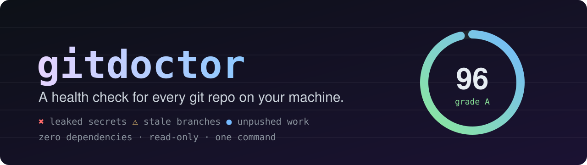
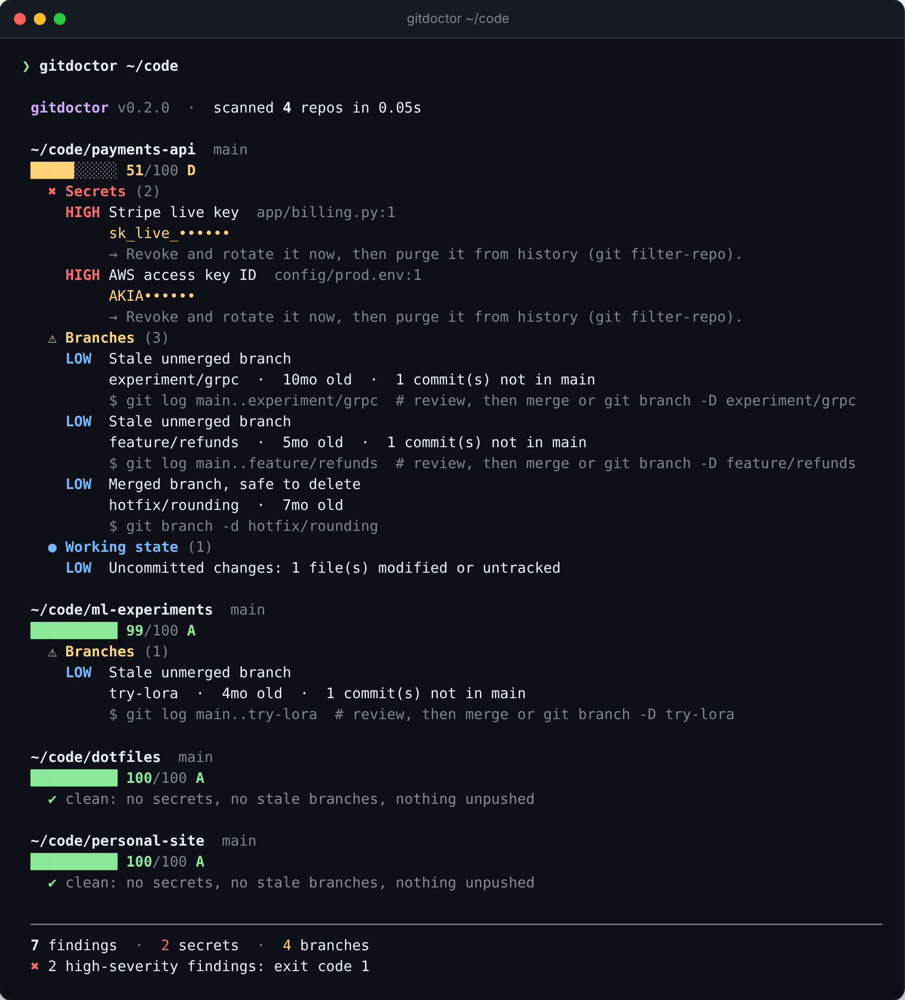
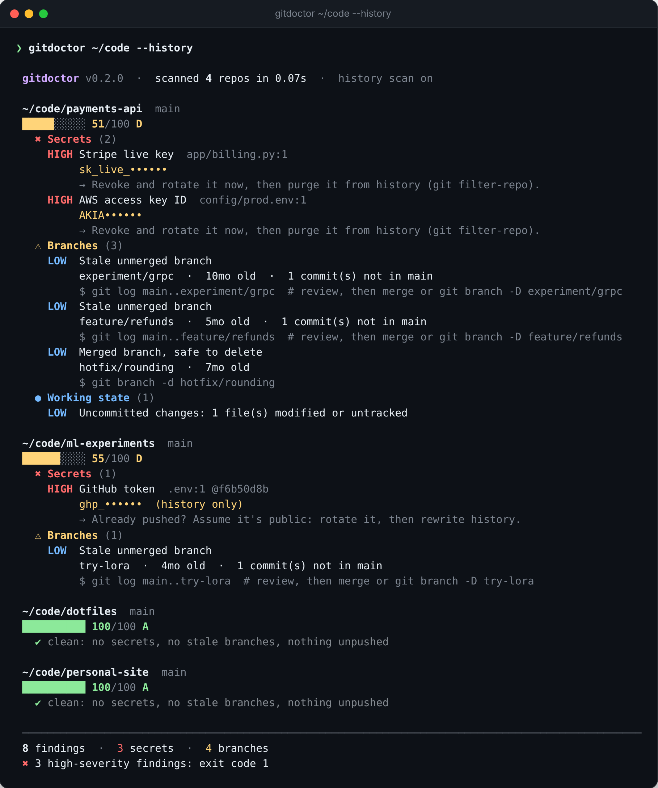
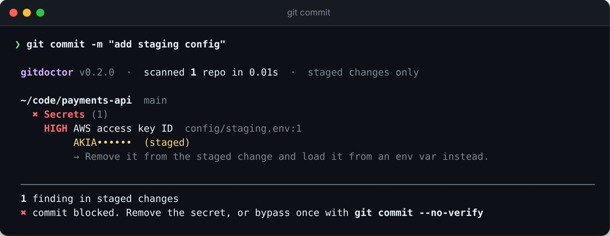

<div align="center">



<br>

[](https://github.com/ajitpanday80/something/actions/workflows/ci.yml)


**Point it at a folder. It finds every git repo inside and tells you which ones leak secrets,<br>hoard dead branches, or hold work that exists only on your laptop.**

</div>

<br>

<p align="center">
  
</p>

## Why

You have dozens of repos. Some have an `.env` you committed at 2 a.m. Some have branches you forgot about two years ago. Some have commits you never pushed. Tools like `git status` only look at one repo at a time, and secret scanners only look for secrets.

`gitdoctor` runs one pass over **all** your repos and gives each a score and a to-do list, with the exact command to fix every item.

## Install

```bash
pipx install git+https://github.com/ajitpanday80/something
```

or, without `pipx`:

```bash
pip install git+https://github.com/ajitpanday80/something
```

Python 3.9+ and `git` on your `PATH`. No other dependencies.

## Use

```bash
gitdoctor ~/code             # scan every repo under ~/code
gitdoctor ~/code --history   # also dig through every past commit
gitdoctor .                  # just this repo (or the repos under this folder)
```

<p align="center">
  
</p>

### What it checks

| | Check | Details |
|---|---|---|
| ✖ | **Leaked secrets** | AWS, GitHub, GitLab, npm, Slack (tokens and webhooks), Stripe live, Google, SendGrid and Anthropic keys; private-key blocks; DB URLs with passwords; plus an entropy-checked, placeholder-aware hardcoded-credential heuristic |
| ✖ | **Secrets in history** | `--history` finds credentials you "deleted" but that still live in old commits |
| ⚠ | **Merged branches** | Safe to delete. Prints the `git branch -d` command |
| ⚠ | **Stale unmerged branches** | Shows how many commits would be lost, and the command to review them first |
| ⚠ | **Branches whose remote was deleted** | Work that may exist only on your machine |
| ● | **Working state** | Uncommitted changes, unpushed commits, branches with no upstream |

### The score

Each repo starts at 100. Secrets cost the most, branches and working state cost a little. **Any high-severity secret caps the repo at 55 (grade D)**, no matter how tidy everything else is. The score is a heuristic to help you sort repos by urgency. It is not a security guarantee.

## History scan

Deleting a secret in a new commit does not remove it. Anyone who can clone the repo can still read it.

<p align="center">
  
</p>

Findings marked `(history only)` are no longer in your files but remain in git history. Treat them as compromised: rotate the credential first, then rewrite history with [`git filter-repo`](https://github.com/newren/git-filter-repo).

## Block secrets before they're committed

Most leaks start with a `git add .`. `gitdoctor --staged` scans only what you are about to commit, so it stays fast and never nags you about old history.

<p align="center">
  
</p>

With the [pre-commit](https://pre-commit.com) framework, add this to `.pre-commit-config.yaml`:

```yaml
repos:
  - repo: https://github.com/ajitpanday80/something
    rev: main          # pin a tag or commit once you cut a release
    hooks:
      - id: gitdoctor
```

Or without any framework, as a plain git hook:

```bash
printf '#!/bin/sh\ngitdoctor --staged\n' > .git/hooks/pre-commit && chmod +x .git/hooks/pre-commit
```

## Use it in CI

Exit code is `1` when something at or above `--fail-on` severity is found (default `high`).

```yaml
- uses: actions/checkout@v4
  with:
    fetch-depth: 0
- run: pipx install git+https://github.com/ajitpanday80/something
- run: gitdoctor . --history --fail-on high
```

Show findings in GitHub's **Security → Code scanning** tab with SARIF:

```yaml
- run: gitdoctor . --history --format sarif --fail-on never > gitdoctor.sarif
- uses: github/codeql-action/upload-sarif@v3
  with:
    sarif_file: gitdoctor.sarif
```

Machine-readable output for dashboards and scripts:

```bash
gitdoctor ~/code --json | jq '.repos[] | select(.score < 60) | .name'
```

## Options

| Flag | Default | What it does |
|---|---|---|
| `--history` | off | Also scan lines added in past commits |
| `--history-depth N` | 1000 | Max commits to scan with `--history` |
| `--stale-days N` | 90 | Age at which a branch counts as stale |
| `--max-depth N` | 4 | How deep to look for repos |
| `--exclude GLOB` | | Skip matching files (repeatable) |
| `--fail-on LEVEL` | `high` | `high`, `medium`, `low` or `never` |
| `--staged` | off | Scan only staged changes (pre-commit hook mode) |
| `--format` | `text` | `text`, `json` or `sarif` (`--json` is a shorthand) |
| `--prune-merged` | off | Delete merged stale branches with `git branch -d`, after asking (`--yes` skips the prompt) |
| `--color` | `auto` | `auto`, `always`, `never` (`NO_COLOR` is respected) |

**Silencing false positives:** put `gitdoctor:ignore` in a comment on that line, or list globs in a `.gitdoctorignore` file at the repo root:

```gitignore
# fake credentials used by tests
tests/fixtures/
*.sample.env
```

## Safety

- **Read-only by default.** It runs `git log`, `git status`, `git for-each-ref` and friends. It never commits, fetches, or changes anything. Fix commands are printed for you to run.
- **The one exception is opt-in.** `--prune-merged` deletes branches, only after you confirm, and only with `git branch -d`, which git itself refuses to run on unmerged work.
- **No network.** Nothing is uploaded or looked up. Your code never leaves your machine.
- **Secrets are never printed in full.** Output shows only a harmless prefix such as `ghp_` or `AKIA`, in both the terminal and `--json` modes. This is covered by tests.

## Limitations (read these)

- **Detection is pattern-based.** It ships a small set of high-signal rules. Dedicated scanners such as [gitleaks](https://github.com/gitleaks/gitleaks) and [trufflehog](https://github.com/trufflesecurity/trufflehog) have far larger rule sets, and trufflehog can verify whether a key is live. For a formal audit, use one of those too. gitdoctor's niche is one fast sweep across *all* your repos with hygiene checks included.
- **It cannot know if a key is still valid.** A finding means "this looks like a credential", not "this is exploitable".
- **Generic matches can be false positives** (and real secrets in unusual formats can be missed). Provider-format rules are written from my knowledge of each format and tested only against synthetic examples, not against live keys.
- **`--history` is bounded** by `--history-depth` and reads diffs, so it will be slow on very large repos.
- Only local branches are checked for staleness, not remote-tracking ones.

## Development

```bash
git clone https://github.com/ajitpanday80/something && cd something
pip install -e ".[dev]"
pytest
```

The test suite builds real temporary git repos, so it exercises actual `git` behaviour. Test tokens are assembled at runtime so that no secret-shaped string is committed to this repository. CI also runs gitdoctor on its own repo, history included.

Regenerate the README images from real output (needs Playwright and ffmpeg):

```bash
pip install playwright pillow
python tools/render_assets.py
```

The hook screenshot is produced by a real `pre-commit` hook blocking a real `git commit` in a throwaway repo.

## Roadmap

- [x] Pre-commit hook mode (`--staged`)
- [x] SARIF output for GitHub code scanning
- [x] `.gitdoctorignore`
- [x] `--prune-merged`
- [ ] Remote-tracking branch checks
- [ ] Publish to PyPI
- [ ] More secret rules, contributed by the community. See `src/gitdoctor/secrets.py`; a rule is one regex and a test

## License

[MIT](LICENSE)
